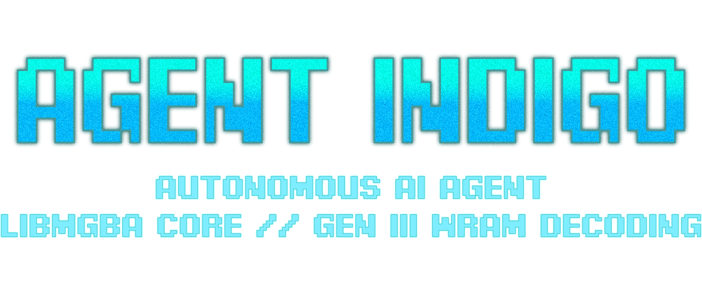

<p align="center">
  
</p>

<p align="center">
  <a href="https://github.com/haggyroth/agent-indigo/actions/workflows/ci.yml"></a>
  <a href="LICENSE"></a>
  
</p>

**Agent Indigo is an autonomous AI agent that plays Pokémon LeafGreen.** It runs the game in an in-process emulator, reads the game's memory directly instead of scraping the screen, and lets a large language model make the decisions — which route to take, which move to use, who to switch in, when to heal — while tested Python code does the button-level work.

The harness covers the whole game: a new game, the eight gyms, Victory Road, the Elite Four and the Hall of Fame, and then the rest of what the game offers — side quests, the Sevii Islands, the legendaries, trades, the Pokédex. A model-free scripted run of the story chain clears the Hall of Fame in about 40 minutes; how far a real model gets depends on the model.

```text
   you  ──  python main.py  ──►  ┌─────────────────────────────────────────────────────────────┐
                                 │  observe        decide                act                   │
   LeafGreen ROM (yours)         │  ┌────────┐    ┌──────────────┐    ┌────────────────────┐   │
          │                      │  │ memory │──► │  LLM (tools) │──► │  skills            │   │
     libmgba (in-process) ◄──────┼──│ reader │    │  any OpenAI- │    │  go_to · use_move  │   │
          ▲                      │  └────────┘    │  compatible  │    │  catch · heal · …  │   │
          └────── button frames ─┼────────────────┴──────────────┴────┴────────────────────┘   │
                                 └─────────────────────────────────────────────────────────────┘
```

## Why it exists

Most "LLM plays a game" projects hand the model raw button presses and a screenshot. That makes the model spend its budget on menu timing and pathfinding, and makes every run unrepeatable. Agent Indigo splits the job instead:

- **The model decides *what*.** A destination, a move, a Pokémon to send in, a quest to start.
- **Code decides *how*.** Each tool is a deterministic skill — A\* over the real tilemap, the exact menu cursor writes, outcomes verified by reading memory back — that either succeeds, or fails cleanly and tells the model why.
- **The harness supplies the context a player would have.** The foe's types and ability, which of the model's moves are super-effective or have *no effect*, what the next gym needs, what the team lacks, which Pokémon a trainer is about to send out. The model should never have to guess what the game already knows.
- **Information, never a wall** — with one deliberate exception. Side quests, missable deadlines and training advice are shown, not forced. The Elite Four's *level* bar is the only hard gate, because a loss resets the whole League.

That makes runs fast (~50× real time, headless), reproducible (deterministic frame stepping, checkpoints, per-save journals) and measurable (an eval harness scores real runs against goals).

## At a glance

| | |
|---|---|
| **Emulator** | [libmgba](https://mgba.io/) driven in-process through a small cffi binding — no GUI, no Lua, no network hop |
| **Observation** | Gen III RAM decoded directly: the XOR-encrypted party structs, badges, map, position, the battle structs, the script engine, the menu state, the Pokédex, the save block's flags |
| **Actions** | 43 high-level tools — navigation, battle, party and PC, shopping, quests for every story beat, HM field moves, trading, and more ([full list](docs/tools.md)) |
| **Story** | 54 quest beats — 22 on the road to the Elite Four, 24 optional side quests, 8 post-game — each a resumable driver or a state-aware plan |
| **Knowledge** | Maps, warps, shops, encounters, learnsets, gym teams, trainer flags and puzzle routes *generated from the [pokefirered](https://github.com/pret/pokefirered) decompilation* by the scripts in `tools/`, not remembered from another game version |
| **Models** | Anything OpenAI-compatible **with tool calling** — LM Studio, Ollama or a cloud endpoint ([models](docs/models.md)) |
| **Memory** | Per-save long-term journal and battle journal; emulator checkpoints you can resume ([details](docs/memory-and-logs.md)) |
| **Quality** | 1,366 hardware-free unit tests, a 224-test live suite against the real ROM that gates every merge, a model-free end-to-end run, and a goal-based eval harness ([testing](docs/testing.md)) |

## Quickstart

You need Python 3.11+, a C compiler, [libmgba](https://mgba.io/), a tool-calling LLM endpoint, and **your own legally obtained** Pokémon LeafGreen (US, v1.0) ROM — the repository contains none.

```sh
git clone https://github.com/haggyroth/agent-indigo.git
cd agent-indigo

python3 -m venv .venv && source .venv/bin/activate
pip install -r requirements.txt

brew install mgba                  # or your distro's libmgba package
python -m game._mgba_build         # compiles the cffi binding

cp .env.example .env               # set ROM_PATH and MODEL_NAME (and LLM_BASE_URL / LLM_API_KEY for a cloud model)
python main.py
```

Start a brand-new game with `START_NEW_GAME=true python main.py`, or continue a cartridge save with `START_FROM_SAVE=path/to/game.sav`. Add `SHOW_WINDOW=true` (needs `pip install pygame`) to watch it play. The [getting-started guide](docs/getting-started.md) walks through every option, local vs cloud models, and troubleshooting.

> The cartridge save is file-backed: an in-game save writes to the `.sav` you started from. Work on a copy if the original matters.

## What the agent can do

| Area | Tools (examples) |
|---|---|
| **Navigate** | `go_to("Pewter City" / "Pokemon Center" / "Mart" / "Gym")` routes across map connections, doors and caves, flies when that is faster, and stops for anything worth the model's attention; `walk_to(x, y)`, `go_to_map(direction)`, `fly_to`, `use_hm` (Surf, Cut, Strength, Flash, Rock Smash), `fish` |
| **Battle** | `use_move`, `switch_pokemon`, `use_item`, `catch`, `flee_battle`, `safari`; the observation ranks moves by type effectiveness, STAB, immunities and foe abilities |
| **Build a team** | `team_report`, `inspect_pokemon` (IVs, nature, quality grade), `pc` (swap, deposit, withdraw), `reorder_party`, `teach_move`, `forget_move`, `tutor`, `daycare`, `give_item`, `rename_pokemon` |
| **Trade** | `trade_evolve` (Kadabra, Machoke, Graveler, Haunter) and `link_trade` (Ekans, Oddish, Psyduck, Growlithe, Shellder, Scyther, Electabuzz) run the game's own Cable Club against a scripted partner — see [the trade partner](#the-trade-partner) |
| **Keep going** | `heal`, `shop`, `grind(level)`, `pick_up_items`, `game_corner`, `save_game`, `save_state` |
| **Play the story** | `quest(...)` — every beat from Oak's parcel to the Champion as a resumable driver: gyms, S.S. Anne, Rocket Hideout, Silph Co., Pokémon Tower, Safari Zone, Victory Road, the League; plus side quests, area sweeps, rematches, the Fame Checker and `quest('achievements')` |
| **Recover** | `advance_dialog`, `close_menus`, `answer_prompt`, `open_menu`, `enter_name`, `read_game_state` |

Skills self-verify against memory, are resumable, and end on any encounter so the **model** plays every battle. The model is only offered the tools that fit the screen (about 1.2k tokens of tool schema in battle, about 5k on the overworld).

## Beyond the critical path

The aim is the whole game, not only the road to the Elite Four. What the harness tracks and drives, all of it information the model can act on or ignore:

- **Side quests with deadlines.** Optional beats are shown with their payoff, their gate and what can be lost — the S.S. Anne sails once you take Cut, the Rocket Hideout trainers vanish when Giovanni falls. `quest()` lists them; the League prep *advises* about the ones still open.
- **Area sweeps.** Every trainer, item ball and hidden item of every named area, read from the game's own flags — `quest('sweep <area>')`.
- **Post-game.** After the Hall of Fame: the National Pokédex, the Sevii Islands (the Seagallop ferry, the Network Machine, Berry Forest, Icefall Cave, the Tanoby Ruins, the move tutors), Mewtwo, Moltres, Zapdos and Articuno, the Trainer Tower, the second League run, VS Seeker rematches and the Fame Checker.
- **The Pokédex.** `quest('dex')` shows what is missing and where each species can be had, including NPC trades, fossils, the Safari Zone and the Game Corner.
- **RetroAchievements, tracked locally.** The 128 achievements of the LeafGreen set (781 points) are mapped to checks the agent reads from the game (124 of them), and `quest('achievements')` shows progress, what can still be lost and what is worth most. This is local tracking only — Agent Indigo is not an RA client and nothing unlocks on the website. `tools/ra_sync.py` can compare your account's real unlocks with a saved state, read-only.

## The trade partner

Some Pokémon only exist through trading: the four trade evolutions, and the version exclusives of the other game. Agent Indigo gets them by running the game's **own Cable Club** against a scripted partner — a second emulator core joined to the first by a virtual link cable (libmgba's SIO lockstep, `game/link.py`). Only buttons are pressed; the link protocol, the trade and the evolution scene are the game's.

- `trade_evolve` trades a Pokémon to the partner, lets it evolve on the receiving side and brings it back.
- `link_trade` trades a Pokémon of yours for a FireRed-only one (the list is generated from the decomp's encounter tables). It needs **your own FireRed ROM** (`FIRERED_ROM_PATH`) and a partner state made by `python tools/make_live_fixtures.py --firered`.
- Setup: `python -m game._mgba_link_build` compiles the link module; `python tools/make_live_fixtures.py --only partner_counter` makes the LeafGreen partner. Until those exist the tools say what is missing instead of failing.

## Watching, resuming and measuring

- **Watch:** `SHOW_WINDOW=true` opens a live pygame view; `LOG_LEVEL=events|debug` controls the terminal stream.
- **Resume:** the agent writes an emulator checkpoint (plus a journal snapshot) every 20 ticks and on every badge — `RESUME=latest python main.py` picks up where a run stopped.
- **One journal per save:** loading a save or state selects the journal that belongs to it, so an old fixture never inherits the milestones of a newer run.
- **Run logs:** every run writes `logs/runs/<timestamp>/run.jsonl` — each LLM call, tool call, event and observation — which makes watched runs easy to mine for bugs (`python tools/analyze_run.py`).
- **Measure:** `python -m evals` scores the real agent loop against goals (reach a city, earn badges, clear the League, unlock achievements) with a step budget, and reports stuck-ratio, event statistics, achievements, calls and tokens.

## Testing without a model

Nothing in the test pipeline calls an LLM.

- **Unit tests** (1,366, hardware-free) run in CI on Python 3.11, 3.12 and 3.13, alongside a macOS job that compiles the native binding and imports libmgba.
- **The live suite** (224 tests) replays real bugs against the real ROM from saved emulator states. It needs the ROM and local fixtures, so it cannot run in CI: `python tools/live_suite.py --changed origin/main --post-status` runs it (about 25 minutes) and posts a `live-suite` commit status for the exact commit, and a PR that touches guarded code stays pending on that status until it is posted. Fixtures are rebuilt from a starting save by `tools/make_live_fixtures.py` ([live CI](docs/live-ci.md)).
- **An end-to-end run without a model.** `python tools/scripted_run.py --goal clear --chain --state saves/live/route23_stuck.ss1` drives the real skills with a rule-based policy through the whole story chain. The reference run clears the Hall of Fame in about 40 minutes. Where it stalls is where a model would too.
- **Evals** (`python -m evals`) run the real decision loop against goals when you do want to measure a model.

## Documentation

| | |
|---|---|
| [Getting started](docs/getting-started.md) | Install, ROM, models, first run, new game vs save, troubleshooting |
| [Architecture](docs/architecture.md) | The decision loop, observation, skills, the knowledge layer, module boundaries |
| [Configuration](docs/configuration.md) | Every environment variable |
| [Tools](docs/tools.md) | The generated tool table |
| [Models](docs/models.md) | Choosing a model, context sizing, spend controls |
| [Memory, journals and logs](docs/memory-and-logs.md) | Long-term memory, per-save journals, checkpoints, run logs |
| [Testing](docs/testing.md) · [Live CI](docs/live-ci.md) | Unit tests, the live suite, the eval harness · why the live suite is attested locally, and how |
| [Reference](docs/reference) | Gen III data structures, RAM map, game knowledge |
| [CLAUDE.md](CLAUDE.md) | The operational reference for AI coding assistants working in this repo |
| [CONTRIBUTING](CONTRIBUTING.md) · [CHANGELOG](CHANGELOG.md) | How to contribute · what changed and why |

## Project layout

```text
main.py            decision loop (build_runtime / run_episode)
config.py          settings from .env
agent/             LLM client, tool schemas, observation builder, skills/ (navigation, battle, quests, trading, …)
game/              libmgba binding, memory reader, tilemap + pathfinding, the two-core link, viewer
knowledge/         type chart, maps, shops, encounters, learnsets, gym teams, story beats, the RA set (much of it generated)
memory/            short-term, long-term and per-save journals, battle journal, checkpoints, run log
evals/             goals, scenarios and the runner (python -m evals)
tools/             data generators (from the decomp), the live-suite runner, fixture and scripted-run tools, RA import and sync
tests/             unit tests; tests/live/ replays real bugs against the real ROM
docs/              guides and reference
```

## Responsible use

Agent Indigo is an independent research and hobby project. It is not affiliated with or endorsed by Nintendo, Game Freak, Creatures Inc., The Pokémon Company or RetroAchievements; *Pokémon* and *LeafGreen* are their trademarks. No ROM, save or game asset is included or distributed — you must supply your own legally obtained copies (a FireRed ROM is needed only for `link_trade`). The agent only observes memory and sets menu cursors the way a D-pad would; it does not modify save data, stats, RNG or battle outcomes (see [architecture](docs/architecture.md#what-the-agent-writes-to-memory)). Credentials for the optional RetroAchievements tools stay in your environment or Keychain and are never printed, logged or committed.

## Acknowledgements

- [mGBA](https://mgba.io/) (MPL-2.0) — the emulator core.
- [pret/pokefirered](https://github.com/pret/pokefirered) — the decompilation the knowledge tables are generated from.
- [RetroAchievements](https://retroachievements.org/) — the achievement set that gives the completion work its checklist.
- The community RAM maps credited in [docs/reference/ram-map.md](docs/reference/ram-map.md).

## License

[MIT](LICENSE).
